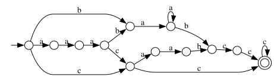

# `MathRegex` - Математический движок регулярных выражений



Учебная реализация движка регулярных выражений на НКА/ДКА.
В отличие от промышленных движков вроде pcre (основанных в основном 
на рекурсивном спуске) некоторых более продвинутых фич нет
(вроде лукэхеадов, матчащих групп и подобных).

Умеет парсить регулярку, генерировать НКА, из него ДКА, из него МПДКА.

Синтаксис вроде стандартных программистских регулярок:

 - Любые буквы как буквы (в том числе и не-латинские, utf8 поддерживается)
 - `a|b` для одного из
 - `(stuff)` для группировки (не capturing группы)
 - `[abc]` для одной буквы из набора
 - `a*` для повтора от 0 раз, `a+` от 1 раза
 - `a?` для опционального
 - `a{3}` или `a{3,5}` для количества повторов

## Запуск

Требует `cmake` для сборки и библиотеки `xxhash`.

```bash
cmake -B build
cd build
make
./demo [nfa|dfa|mpdka] REGEX # выдаст dot представление
./demo nfa '(a+b+)*' | xdot - # удобный просмотрщик
```

## TODO

- [x] Ядро
- [x] Парсер regex (сразу строящий автомат)
- [x] Детерминизация
- [x] Минимизация
- [ ] Генерация регулярки из автомата
